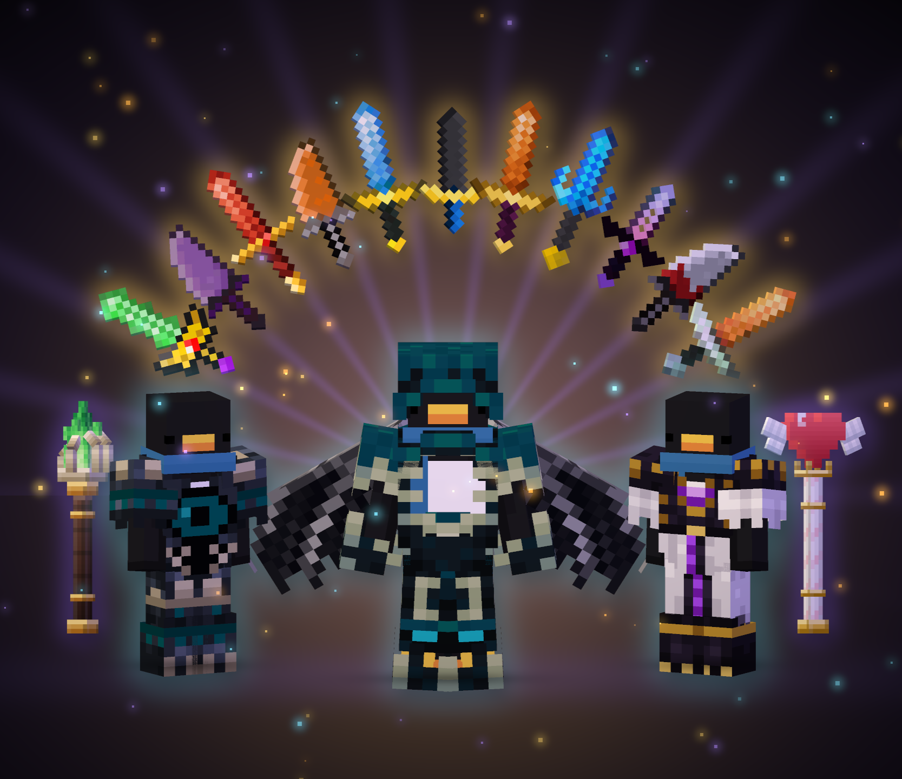

# zKraft – Texture pack degli item

Resource pack del server Minecraft **zKraft** (`mc.zkraft.net`): armi, armature, scudi e oggetti custom con
texture dedicate, modelli 3D e animazioni. Gli item cambiano aspetto in base al **nome** che hanno in gioco.

## Requisiti

- **Minecraft Java 1.21.11** con **Fabric Loader** e **Fabric API**
  (provato su 1.21.11; per **1.21.8** c'è uno ZIP a parte, vedi Installazione, da usare con
  **CitFancy** al posto di CIT Resewn: la fork di CIT Resewn per 1.21.8 mostra blocchi glitchati)
- Mod lato client:

| Mod | A cosa serve | Obbligatoria |
|---|---|---|
| [CIT Resewn fork](https://modrinth.com/mod/cit-resewn-fork) su 1.21.11, [CitFancy](https://modrinth.com/mod/citfancy) su 1.21.8 | Texture e modelli degli item in base al nome | Sì |
| [Entity Model Features](https://modrinth.com/mod/entity-model-features) + [Entity Texture Features](https://modrinth.com/mod/entitytexturefeatures) | Spuntoni 3D della Corazza Eclipse e Cappello della Befana 3D indossati | No (senza, la corazza resta piatta e il cappello diventa un cappello piatto sull'elmo) |
| [Variants CIT](https://modrinth.com/mod/variants-cit) | Nasconde i trim sui set Eclipse, Dream, Aragon, Caligola, Anubi, Convergenza, Colosso, Caos, Soffio Vitale, Cleopatra, Pyramid, Infermiera, Valtiel e i set romani (Gladiatore, Legionario, Centurione, Tribuno, Legatus, Imperatore) e Gellir | No (senza, il trim si vede sopra l'armatura) |

### Versioni testate

Il pack è stato provato in gioco con queste versioni esatte delle mod:

| Minecraft | ZIP | Mod |
|---|---|---|
| 1.21.11 | `zkraft.zip` | [CIT Resewn fork 1.0](https://modrinth.com/mod/cit-resewn-fork/version/3bjfw6Xx), [Variants CIT 5.5.0+1.21.9](https://modrinth.com/mod/variants-cit/version/tSXo271z), [EMF 3.2.4](https://modrinth.com/mod/entity-model-features/version/CWZPvNbk), [ETF 7.1](https://modrinth.com/mod/entitytexturefeatures/version/rAQimlSn) |
| 1.21.8 | `zkraft-1.21.8.zip` | [CitFancy v2-1.21.8](https://modrinth.com/mod/citfancy/version/l2XKjWY1), [EMF 3.2.4 (1.21.6–1.21.8)](https://modrinth.com/mod/entity-model-features/version/rPlvbW7d), [ETF 7.1 (1.21.6–1.21.8)](https://modrinth.com/mod/entitytexturefeatures/version/LhiABkEc) |

Su 1.21.8 non usare la fork di CIT Resewn per 1.21.8: mostra blocchi glitchati.

## Installazione

1. Scarica **[zkraft.zip](https://github.com/guofede/z-items-texturepack/releases/download/pack/zkraft.zip)**
   (è sempre l'ultima versione).
   Su **1.21.8** scarica invece
   **[zkraft-1.21.8.zip](https://github.com/guofede/z-items-texturepack/releases/download/pack/zkraft-1.21.8.zip)**:
   è lo stesso pack adattato a CitFancy (le armature di cuoio possono avere una leggera tinta del cuoio).
2. Metti lo ZIP **così com'è** in `.minecraft/resourcepacks/`: non serve estrarlo.
3. In gioco: **Opzioni → Pacchetti risorse** e attiva *zkraft.zip*.
   Se usi altri pack che cambiano armi o armature, metti zKraft **sopra** di loro.
4. Per aggiornare, scarica di nuovo lo ZIP, sostituisci quello vecchio e premi **F3+T** in gioco.

> Non usare **Code → Download ZIP** di GitHub: mette tutto dentro una sottocartella e Minecraft non lo riconosce.

## Come funziona

- Ogni item custom è un item vanilla (spada, ascia, scudo, bussola…) con un **nome preciso**.
  Il pack riconosce il nome che **inizia** con quello indicato, rispettando **maiuscole e minuscole**
  (es. `Primo peccato`, non `Primo Peccato`).
- Gli item ufficiali li dà il server già con il nome giusto. Per provarli puoi rinominare l'item base in un'incudine.
- **Armature:** ogni pezzo cambia sia l'icona sia l'aspetto indossato. I Gambali di Dream e di Aragon sono in cuoio:
  il colore della tintura non li influenza.
- **Teste di player** (es. *Apocalisse*): il modello si vede in mano, nell'inventario e per terra; indossate
  mostrano sempre la skin della testa (limite di Minecraft).
- Alcuni item sono **animati** (Amuleto di Silent Hill, Satanic, Zanna del Sangue Versato, Senza Tempo per
  Spiegare, Ramo della Vita, Emblema del Guaritore, Talismano delle tre virtù, Chiave IcyBlue Crates, le radio…).

## Elenco degli item

### Armature

| Nome | Item base |
|---|---|
| Elmo / Corazza / Stivali di Aragon | netherite (elmo, corazza, stivali) |
| Gambali di Aragon | leather_leggings |
| Corazza / Stivali di Dream | netherite_chestplate / netherite_boots |
| Gambali di Dream | leather_leggings |
| Corazza / Gambali / Stivali Eclipse | netherite (corazza, gambali, stivali) |
| Corazza / Stivali di Gellir | netherite_chestplate / netherite_boots |
| Gambali di Gellir | leather_leggings (la tintura non li colora) |
| Corazza / Gambali / Stivali di Cleopatra | oro (corazza, gambali, stivali) |
| Corazza / Stivali di Caligola | golden_chestplate / golden_boots |
| Gambali di Caligola | netherite_leggings |
| Corazza / Stivali di Anubi | netherite_chestplate / netherite_boots |
| Gambali di Anubi | golden_leggings |
| Corazza / Gambali / Stivali della Convergenza | netherite (corazza, gambali, stivali) |
| Corazza / Gambali / Stivali del Colosso | netherite (corazza, gambali, stivali) |
| Corazza / Gambali / Stivali del Caos | netherite (corazza, gambali, stivali) |
| Corazza / Stivali del Soffio Vitale | leather_chestplate / leather_boots (la tintura non li colora) |
| Gambali del Soffio Vitale | golden_leggings |
| Corazza / Gambali / Stivali di Pyramid | leather (corazza, gambali, stivali; la tintura non li colora) |
| Camice / Grembiule / Scarpe dell'Infermiera | ferro (corazza, gambali, stivali) |
| Corazza / Gambali / Stivali di Valtiel | netherite (corazza, gambali, stivali) |
| Corazza / Gambali / Stivali del Gladiatore | leather (la tintura non li colora) |
| Corazza / Gambali Legionario | iron_chestplate / iron_leggings |
| Stivali Legionario | leather_boots (la tintura non li colora) |
| Corazza Centurione | chainmail_chestplate |
| Gambali Centurione | iron_leggings |
| Stivali Centurione | leather_boots (la tintura non li colora) |
| Corazza / Gambali / Stivali Tribuno | diamond (corazza, gambali, stivali) |
| Corazza / Gambali / Stivali Legatus | netherite (corazza, gambali, stivali) |
| Corazza / Gambali / Stivali dell'Imperatore | oro (corazza, gambali, stivali) |
| Cappello della Befana (3D anche indossato, con EMF) | leather_helmet |
| Tunica della Befana | leather_chestplate |
| Ali del Drago, Ali di Eolo, Ali di Odino | elytra |

### Spade, pugnali e spadoni

| Nome | Item base |
|---|---|
| Absoluzione, Lama Natalizia, Sciabola del Titano, Spada di Cupido, Spada di Napoleone, Spezzarealtà, Ultimo Ricordo, Yami no Hibiki | iron_sword |
| Castigo, Condanna Eterna, Fine della Misericordia, Picco Glaciale | diamond_sword |
| Pugnale del Faraone Ramses, Pungiglione di Gaia, Satanic, Sciabola d'Abbordaggio, Spadone del Colosso Dormiente, Viperia | golden_sword |
| Onyx del Vuoto | stone_sword |
| Croce del Deserto, Delirium, Excalibur, Fendente Oscuro, Ferrum Aeternum, Frattura dell'Unità, Furia, GingerBeard, Giudizio del Mietitore, Gladius Imperatoris, Ira del Colosso, L'Ira di Dreamweaver, Lama degli Spiriti Antichi, Lama del Faraone, Lama di Marte, Oblivion, Onirica, Ordine Supremo, PhantomLight, Pugio, Pugnale di Cleopatra, Redenzione Perduta, Scacciafantasmi, Scorpione, Secutor, Setekh, Sogno di Alessandria, Spezza Fato, StarLight, Vindicta, Zanna del Sangue Versato, Zanna di Anubi | netherite_sword |
| Bisturi Arrugginito | shears |
| Apocalisse (stocco 3D) | player_head |

### Asce, martelli e falci

| Nome | Item base |
|---|---|
| Ascia del Paradosso, Ascia della Sabbia Eterna, Chimera, Decollator, Grande Ascia dell'Inferno, Schiaccia Carne (martello 3D) | netherite_axe |
| Decapitatrice, Guardiano delle Ombre (martello 3D) | diamond_axe |
| Falce Faraonica | golden_axe |
| Falce del Mietitore | iron_hoe |
| Falce di Pyramid | netherite_hoe |

### Archi, balestre e lance

| Nome | Item base |
|---|---|
| Arco Acchiappa Sogni, Sagitta Divina | bow |
| Balista Minor | crossbow |
| Primo peccato | carrot_on_a_stick |

### Scudi

Custode della Cripta, Egida del Colosso, Presagio Rosso, Scudo del Sole Infranto, Scudo della Legione, Scudo di Cleopatra,
Scutum Aegis, Sepolcro Vivente — tutti su `shield`.

### Staffe e armi speciali

| Nome | Item base |
|---|---|
| Illusio, Sussurro di Ra, Vox Sibyllae | netherite_hoe |
| Ramo della Vita (3D, animato) | wooden_hoe |
| Bastoncino di Zucchero, Big White Wand, Senza Tempo per Spiegare | blaze_rod |
| Spara Ghiaccio | diamond_hoe |
| Spara Ragnatele, Mangia Vuoto, Passatempo Cristallino, Lancia Marina | fishing_rod |
| Ignis Rose | wither_rose |
| The Big Black | black_dye |
| Artigli di Valtiel | netherite_scrap |
| Guanto del Tradimento Invernale | dragon_head |

### Talismani e oggetti

| Nome | Item base |
|---|---|
| Amuleto di Silent Hill | clock |
| Talismano da Guerra | goat_horn |
| Talismano della Difesa | shield |
| Talismano delle tre virtù | respawn_anchor |
| Emblema del Guaritore (animato) | emerald |
| Radio Disturbata | recovery_compass |
| Radio di Temu | compass |
| Camera | spyglass |
| Piccone di Enlin | golden_pickaxe |
| Pietracciaio | iron_ingot |
| Pietradura | prismarine_shard |
| Pietralama | ghast_tear |
| Chiave Artefatto | cyan_dye, prismarine_shard |
| Chiave Claim | yellow_dye, prismarine_shard |
| Chiave End | prismarine_shard |
| Chiave Guerriero | brown_dye, prismarine_shard |
| Chiave Halloween | fermented_spider_eye |
| Chiave IcyBlue Crates (3D, animata) | prismarine_shard |
| Chiave Nether | prismarine_shard |
| Chiave Spawner | blue_dye, prismarine_shard |
| Chiave Supremo | purple_dye, prismarine_shard |
| Chiave VIP | qualsiasi colorante, prismarine_shard |
| Chiave Voto | prismarine_shard |
| Chiave Dungeon | red_dye |

## Struttura del pack (per chi ci lavora)

```
assets/minecraft/optifine/cit/<categoria>/<item>/   texture, modelli e .properties di ogni item
overlay_1_21_9/assets/minecraft/emf/cem/            modelli EMF (Corazza Eclipse 3D, cappello Befana);
                                                    nell'overlay solo per 1.21.9+, su 1.21.8 davano cubi glitchati
assets/zkraft/variants-cit/modules/                 regole Variants CIT (trim nascosti)
```

Ogni item ha un file `.properties` come questo:

```
type=item
items=netherite_sword
nbt.display.Name=pattern:Nome dell'Item*
texture=nomeitem
```

- L'asterisco va solo **alla fine** del nome.
- Per gli item senza una texture unica (orologio, bussola, teste di player, blocchi come il respawn anchor) o per i modelli 3D serve anche
  `model=<file .json>`.
- Le texture animate sono una striscia verticale di fotogrammi con un file `.png.mcmeta` accanto.
